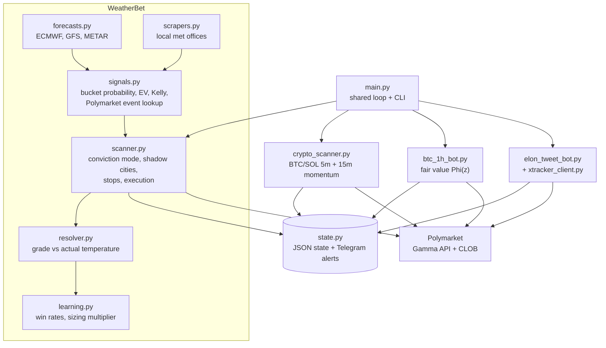

# polymarket-trading-system

> **Disclaimer.** This is an educational and research project. It is not financial advice.
> Prediction markets and crypto are risky and you can lose all of the money you put in.
> Use this code at your own risk. The results below include real losses.

## Summary

This is my first Polymarket trading system, kept as an honest engineering journal. It is
one Python process that runs several bots on a shared loop: a weather bot that trades
next-day temperature markets from calibrated forecasts, momentum scanners for BTC and SOL
5-minute and 15-minute up/down markets, an early fair-value bot for BTC 1-hour markets, and
a paper-only bot for weekly tweet-count markets. Some parts found a real edge, some lost
money, and the failures taught me more than the wins. This README records what worked,
what broke, why, and what I changed. The lessons led to a full rebuild, linked at the end.

## What's inside

| Bot | Markets | Approach | Status |
|---|---|---|---|
| **WeatherBet** (`scanner.py`) | Daily high temperature, 1-degree buckets | Station-calibrated forecasts, bucket probabilities, EV and Kelly, conviction mode | Paper. 4 calibrated cities traded, 14 shadow cities logged |
| **BTC/SOL 5m and 15m scanners** (`crypto_scanner.py`) | Crypto up/down | Six-module momentum vote | Paper (BTC 15m paused after live losses) |
| **BTC 1h bot** (`btc_1h_bot.py`) | BTC hourly up/down | Fair value `P = Phi(z)` vs the book, maker-first | Prototype of the rebuild |
| **Elon tweet bot** (`elon_tweet_bot.py`) | Weekly tweet-count buckets | Pace projection from Polymarket's XTracker | Paper only, paused by default |

### WeatherBet

Polymarket lists markets on the next day's maximum temperature in a city, split into
1-degree buckets. Each market resolves on one specific weather station, usually the
airport, not the city centre. The bot:

1. Pulls ECMWF and GFS forecasts from Open-Meteo **at the resolution station's
   coordinates**, plus METAR observations and local met-office pages (Hong Kong
   Observatory, Singapore NEA, Korea KMA, India IMD and others).
2. Corrects each station's known bias and estimates forecast uncertainty (`sigma`) from
   past errors, preferring a learned value once enough trades have resolved.
3. Turns the forecast into a probability for each bucket:
   `P(bucket) = Phi((t + 0.5 - forecast) / sigma) - Phi((t - 0.5 - forecast) / sigma)`.
4. Computes EV against the market price and sizes with 25% fractional Kelly.
5. **Conviction mode:** across all cities, takes only the top two candidates per day
   (hard caps $10 and $5, EV at least 0.15). Everything else is logged, not traded.
6. **Shadow mode:** uncalibrated cities are scanned and their best candidate is graded
   against the real temperature with a $1 simulated stake, but never traded. A city is
   promoted only after about 15 resolved shadow trades with positive simulated P&L.
7. A learning module tracks win rate by price range and entry session and adjusts sizing.

### BTC/SOL 5m and 15m scanners

A weighted vote of six modules: trend (EMA slope and candle structure), support and
resistance levels, live momentum, perpetual funding rate, open-interest change, and a
contrarian RSI/VWAP reversal module. A conflict gate skips trades when the modules
disagree too much, and DOWN trades need twice the edge of UP trades. Loss streaks halt a
market class, with streak isolation so old losses cannot re-trigger a halt.

### BTC 1h bot

The first fair-value model: `P(close > strike) = Phi(z)` from the move since the hourly
open and realised volatility, with small funding and open-interest nudges. It trades only
when fair value and the book differ by at least 8 cents, using post-only maker orders.

## Architecture



## Results, failures and fixes

These are the real numbers recorded during development (May and June 2026).

### Weather: calibration is everything

The first 36 resolved weather trades:

| Split | Result |
|---|---|
| Calibrated cities | **+$8.11** (57% win rate) |
| Uncalibrated cities | **-$71.15** (5% win rate) |
| NO trades (fading a bucket) | **8/13** won (62%), **+$40.73** |
| YES trades (buying a bucket) | **1/23** won (4%), **-$103.77** |

**Causes:**

- Cities without a measured station bias were trading on forecasts the bot had no right
  to trust.
- Buying a single bucket (YES) needs the forecast to land inside a 1-degree range. Fading
  an unlikely bucket (NO) is far more forgiving.
- 12 of the 36 trades were stopped out by intraday price noise, not by any change in the
  forecast.
- Bucket distance was too loose. One Chicago trade bought the 62°F bucket on a 60°F
  forecast (1.1°C away), and even a perfect forecast would have lost.

**Changes:**

- Only 4 calibrated cities trade (Hong Kong, Singapore, Tokyo, Seoul). The other 14 moved
  to shadow mode and must earn promotion.
- Direction-asymmetric thresholds: NO needs EV of at least 0.15, YES at least 0.25.
- Maximum distance from forecast to bucket tightened from 1.5°C to 1.0°C.
- Information-gated stop: the 20% price stop only fires if the forecast has also moved
  against the position. Otherwise the trade is held to resolution.

### BTC 15m: 0/17 live

BTC 15m went live at $1 per trade and lost all **17** trades (**-$17**) before I paused it.

**Causes:**

1. **Paper grading used the wrong rule.** Paper trades were graded on the close versus the
   bot's entry price, but these markets resolve on the close versus the **window open**.
   Paper results looked far better than reality.
2. **Strike-blind signal.** The momentum vote never looked at where the price stood
   relative to the window open, which is the only thing that decides the market.
3. **Adverse selection on taker orders.** Fill-or-kill orders crossed the spread and only
   filled 17 of 44 times, and the fills that did happen were the ones the market was happy
   to give away.

**Changes:** live trading paused; all four 5m/15m scanners re-graded on the real rule,
using the Binance window open and close; pre-fix paper stats tagged and excluded; a
time-of-day filter added for BTC 15m after diagnostics showed a 38.7% win rate between
12:00 and 16:00 UTC.

### The oracle bug this repo still has

The fix above graded on Binance candles. Polymarket's 5-minute and 15-minute BTC markets
actually settle on the **Chainlink BTC/USD data stream**, not Binance. The two differ by a
few dollars at the resolution tick, which is enough to flip a near-tie window. Nothing in
this codebase reads Chainlink. Finding this was one of the main reasons for the rebuild,
which routes every market to the feed it really settles on and grades every trade off
Polymarket's own resolution.

## Lessons learned

- **Price and grade against the exact resolution source.** For weather that is a specific
  airport station. For crypto it is a specific oracle feed. Close enough is not enough.
- **Paper results are only as honest as the grading.** Two separate grading bugs made
  paper look profitable while live lost money.
- **Calibrate before trading, and make new markets earn their way in.** Shadow mode costs
  nothing and filters out the cities that would have lost.
- **Taker orders on short crypto markets get picked off.** The rebuild is maker-first.
- **Momentum votes at a 5 to 15 minute horizon mostly trade noise.** Pricing the
  probability directly (the 1h bot's approach) is the better foundation.
- **Stops should react to information, not to price noise.**
- **Every JSON loader needs a guard.** Corrupt or empty state files now load safe defaults
  instead of crashing the loop.
- **Exact matching beats fuzzy matching.** Fuzzy market lookup once pulled stale markets.
  Discovery now validates exact slugs.

## Tech stack

Python (tested on 3.14), `requests`, `python-dotenv`, JSON files for state, Telegram for
alerts, `pytest`. Data sources: Open-Meteo (ECMWF, GFS, archive), aviationweather.gov
METAR, national met-office pages, Visual Crossing, Binance, Gate.io, CoinGecko, and the
Polymarket Gamma, CLOB and XTracker APIs. Live trading uses `py-clob-client-v2`.

## Setup

```bash
git clone https://github.com/mikkylulz/polymarket-trading-system.git
cd polymarket-trading-system
python -m venv .venv
source .venv/bin/activate          # Windows: .venv\Scripts\activate
pip install -r requirements.txt
cp .env.example .env               # paper mode runs with every value empty
```

Paper mode (`"paper_mode": true` in `config.json`, the default) needs no keys. Without
Telegram credentials, alerts go to the log. Optional keys:

- **Telegram alerts:** create a bot with [@BotFather](https://t.me/BotFather), then put
  the token and your chat ID in `TELEGRAM_TOKEN` and `TELEGRAM_CHAT_ID`.
- **Visual Crossing** ([visualcrossing.com](https://www.visualcrossing.com/), free tier):
  `VC_API_KEY`, used to cross-check actual temperatures.
- **Live trading:** Polymarket CLOB credentials, the per-bot `*_LIVE_MODE` flags, and
  `pip install py-clob-client-v2`. Not recommended: see the results above.

Strategy settings (cities, EV thresholds, bet sizes, stops, scan intervals) live in
`config.json`. Runtime state and logs are written to `data/`, which is gitignored.

## Run

```bash
python main.py                  # main loop: weather scans plus the crypto scanners
python main.py scan             # one weather scan across all cities (takes several minutes)
python main.py status           # open positions and P&L for every bot
python main.py report           # detailed report
python main.py learn            # learning report: win rates by price range and session
python main.py 1h-paper-test    # BTC 1h bot in paper mode
python main.py 1h-status        # BTC 1h trades
python main.py elon             # Elon tweet bot (paper only)
python main.py elon-status
python main.py btc-clear-halt   # clear a BTC loss-streak halt (also sol-clear-halt)
python main.py reset            # delete local market, state and historical data
```

One-off analysis scripts used during development live in `scripts/`. Run them from the
repo root, for example `python scripts/diag_15m.py`. They read trade files under `data/`.

## Tests

```bash
pytest
```

29 tests cover the pure maths: bucket label parsing and Fahrenheit conversion, bucket
probability (centring, distance, clamping, the no-forecast prior), EV, fractional Kelly
sizing and caps, sigma selection, the normal CDF, and the BTC 1h fair-value model
(symmetry, time decay, clamping, settled windows). They run offline in under a second.

## Project layout

```
main.py              shared loop and CLI
config.py            loads config.json and .env
config.json          strategy settings (no secrets)
state.py             JSON state, guarded loaders, Telegram alerts
forecasts.py         ECMWF, GFS, JMA, HRRR, METAR, NWS discussion, pressure trend
scrapers.py          local met-office forecasts
signals.py           bucket maths, EV, Kelly, Polymarket event lookup, trade finding
scanner.py           weather scan, conviction mode, shadow cities, stops, execution
resolver.py          grades weather trades against actual temperatures
learning.py          win-rate tracking and sizing multiplier
crypto_scanner.py    BTC/SOL 5m and 15m scanners
btc_1h_bot.py        BTC 1h fair-value bot
elon_tweet_bot.py    tweet-count bot
xtracker_client.py   XTracker API client
scripts/             one-off diagnostics
tests/               pytest suite
```

## What came next: Btc_trading_bot

The crypto lessons here led to a ground-up rebuild:
**[Btc_trading_bot](https://github.com/mikkylulz/Btc_trading_bot)**. It drops the momentum
vote for a single fair-value model, routes every market to the oracle it actually settles
on (Chainlink, not Binance), grades every trade off Polymarket's own resolution, executes
maker-first, keeps trades in SQLite, and blocks live trading until a paper-validation
record proves positive expected value after fees. It has 110 automated tests.

## License

MIT. See [LICENSE](LICENSE).
